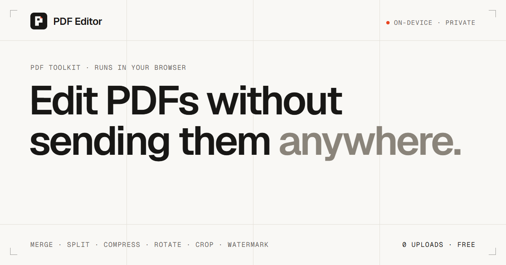

<div align="center">


# Yours PDF

**A free PDF editor that runs entirely in your browser.**
Unlimited edits, any file size, and your files are never uploaded.

[**Open Yours PDF →**](https://yours-pdf.vercel.app)



</div>

---

## Why

Most online PDF tools upload your document to a server, cap the file size, and limit how many times you can use them. Yours PDF does all the work on your own device, with JavaScript in the browser, so:

- **Private:** files never leave your computer or phone. There is no server, account or tracking of your documents.
- **Unlimited:** no file size limit (only your device's memory) and no cap on how many edits you make.
- **Fast:** nothing to upload or download in between steps, and results can be passed straight to the next tool.

## Tools

| Tool | What it does |
|---|---|
| **Edit PDF** | Click any text to see its font, size and colour; edit or remove it; add new text; draw rectangles, ellipses and lines in any colour. |
| **Watermark** | Brush over a watermark to remove it (vector watermarks are removed from the PDF itself), or add a text or image watermark with live preview and a before/after slider. |
| **Merge PDF** | Combine several PDFs in the order you choose. |
| **Split PDF** | Extract page ranges, split every N pages, or save each page as its own file. |
| **Organize PDF** | Reorder pages by dragging, rotate, duplicate or delete them, and insert blank pages or pages from another PDF. |
| **Rotate PDF** | Rotate all pages or a page range. |
| **Compress PDF** | See the estimated file size for each setting before compressing. |
| **PDF Size Changer** | Fit a PDF under a target size such as 200 KB or 2 MB, or pad a small file up to it. |
| **Crop PDF** | Trim margins, linked on all sides or set per side, with a live preview. |
| **Resize PDF** | A4, A5, A3, Letter, Legal, Tabloid or a custom size in mm, inches or points, with a to-scale size reference. |
| **Adjust Colors** | Grayscale, black & white, invert, or fine-tune brightness, contrast and saturation. |

The editor also has Figma-style zoom and pan (Ctrl/⌘ + scroll, pinch, Space + drag), a live preview for every tool, and light and dark themes.

## How it works

- **Rendering:** [pdf.js](https://github.com/mozilla/pdf.js) draws pages into canvases, re-rendering sharply at the current zoom and only near the screen.
- **Editing:** [pdf-lib](https://github.com/Hopding/pdf-lib) changes the PDF itself (merge, split, rotate, crop, resize, watermarks, text and shapes), so text stays real, selectable text.
- **Watermark removal:** first looks for the watermark in the PDF's own drawing instructions and switches it off there; anything left (e.g. in a scan) is cleaned pixel by pixel, treating the watermark as a see-through layer.
- **Text editing:** fonts inside PDFs usually contain only the letters already used, so edited text is redrawn in the closest standard font (Helvetica, Times or Courier) at the original size, position and colour.
- **Size estimates:** a few sample pages are compressed at several settings and scaled up to the full document.

## Tech stack

React 18 · TypeScript · Vite · Tailwind CSS · Radix UI · pdf.js · pdf-lib · JSZip. Deployed on Vercel.

## Run it locally

Requires Node.js 18 or newer.

```bash
git clone https://github.com/AneeshRahman/PDF-editor.git
cd PDF-editor
npm install
npm run dev        # http://localhost:5173
```

| Command | |
|---|---|
| `npm run dev` | Start the development server |
| `npm run build` | Type-check and build for production into `dist/` |
| `npm run preview` | Serve the production build locally |
| `npm run lint` | Run ESLint |

## Project structure

```
src/
  pages/            Home, tool page, 404
  components/       Layout, PDF preview (zoom, pan, overlays), results screen
    tools/          One panel per tool (Edit PDF, Watermark, Organize, ...)
  lib/
    tools.ts        Tool registry: name, icon, panel, related tools
    pdf-operations.ts   Merge, split, rotate, crop, resize, compress, target size
    pdf-edit.ts         Text detection (font, size, colour) and edits
    watermark.ts        Pixel-level watermark detection and cleaning
    vector-watermark.ts Removes watermarks from the PDF's drawing instructions
    stamp.ts            Adding text or image watermarks
    seo.ts              Titles, descriptions and structured data per page
```

## Deploying

The build pre-renders an HTML file per tool (with its own title, description and social tags) and writes `sitemap.xml`, `robots.txt` and `404.html`. Optional environment variables:

| Variable | Purpose |
|---|---|
| `SITE_URL` | Public URL for canonical links, the sitemap and social images. Defaults to `https://yours-pdf.vercel.app`. |
| `GOOGLE_SITE_VERIFICATION` | Google Search Console ownership tag. |
| `BING_SITE_VERIFICATION` | Bing Webmaster Tools ownership tag. |

## Limitations

- Edited text uses the closest standard font, and characters outside Western European languages can't be typed into it.
- Compress, PDF Size Changer and Adjust Colors save pages as images, so text in the result isn't selectable.
- Very large files are limited by your device's memory.

## Author

Made by [@aneeshRahman](https://github.com/aneeshRahman/). Issues and suggestions are welcome.

## License

[MIT](LICENSE)
